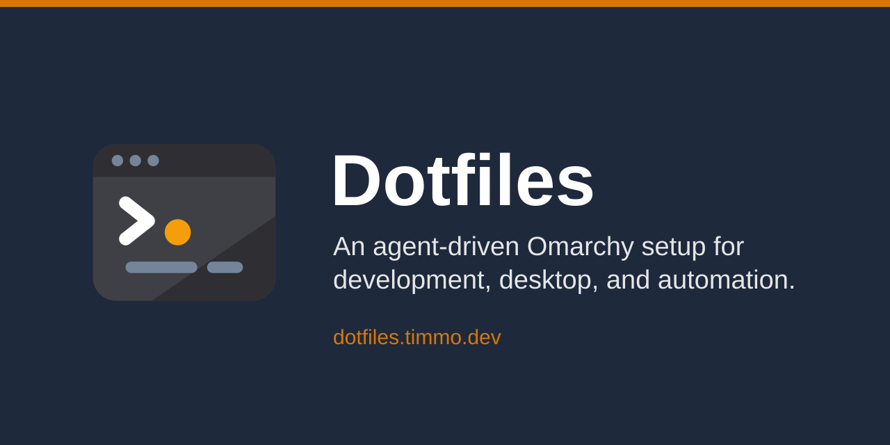

# Dotfiles



Personal [Omarchy](https://omarchy.org) dotfiles, managed with [GNU Stow](https://www.gnu.org/software/stow/) and the `dot` command.

> [!NOTE]
> This is the `distro/ubuntu-server` branch: a headless Ubuntu server build with the terminal and service tooling only, and a Herdr server for remote clients. See [SERVER.md](SERVER.md) for what changed and what is still to do. The desktop setup lives on `distro/arch-omarchy-quattro`.

**Docs:** <https://ubuntu-server.dotfiles.timmo.dev> (desktop: <https://dotfiles.timmo.dev>)

> [!CAUTION]
> This repository is for reference. The configs are tuned for Omarchy and my machines, with a private overlay that is not public, so installation is not recommended. Have your agents borrow the pieces you want instead.

## Quick start

```bash
# Public source of truth; stow packages live under this checkout
git clone git@github.com:timmo001/dotfiles.git ~/.config/dotfiles

# Private overlay clone during init needs an authenticated gh
gh auth status || gh auth login

cd ~/.config/dotfiles

# Allow this repo's mise.toml, then install the pinned toolchain
mise trust
mise install

# Build the checked-out binary before it is on PATH
mise run dot:build

# First-use setup (pulls private overlay when gh auth works)
~/.config/dotfiles/scripts/.local/bin/dot init
```

Ongoing: `dot doctor` (health checks), `dot update` (pull, stow, rebuild).

## Docs map

- [Overview](https://ubuntu-server.dotfiles.timmo.dev/)
- [Getting started](https://ubuntu-server.dotfiles.timmo.dev/getting-started/)
- [Distros](https://ubuntu-server.dotfiles.timmo.dev/distros/)
- [Configuration](https://ubuntu-server.dotfiles.timmo.dev/configuration/)
- [`dot`](https://ubuntu-server.dotfiles.timmo.dev/dot/overview/) · [command reference](https://ubuntu-server.dotfiles.timmo.dev/dot/commands/)
- [Server](https://ubuntu-server.dotfiles.timmo.dev/server/overview/) · [Herdr](https://ubuntu-server.dotfiles.timmo.dev/server/herdr/)
- [Stow packages](https://ubuntu-server.dotfiles.timmo.dev/stow/)
- [Agents](https://ubuntu-server.dotfiles.timmo.dev/agents/overview/) · [skills](https://ubuntu-server.dotfiles.timmo.dev/agents/skills/)
- [OpenCode](https://ubuntu-server.dotfiles.timmo.dev/agents/opencode/overview/) · [agents](https://ubuntu-server.dotfiles.timmo.dev/agents/opencode/agents/) · [commands](https://ubuntu-server.dotfiles.timmo.dev/agents/opencode/commands/) · [plugins](https://ubuntu-server.dotfiles.timmo.dev/agents/opencode/plugins/)
- [Pi](https://ubuntu-server.dotfiles.timmo.dev/agents/pi/)

Detail lives in code and `--help`. The site stays a short what-and-why reference.

## Layout

- `dot/` — `dot` CLI source
- `docs/` — docs site
- `agents/` — OpenCode config
- Stow packages for shell, editor, and related tools
