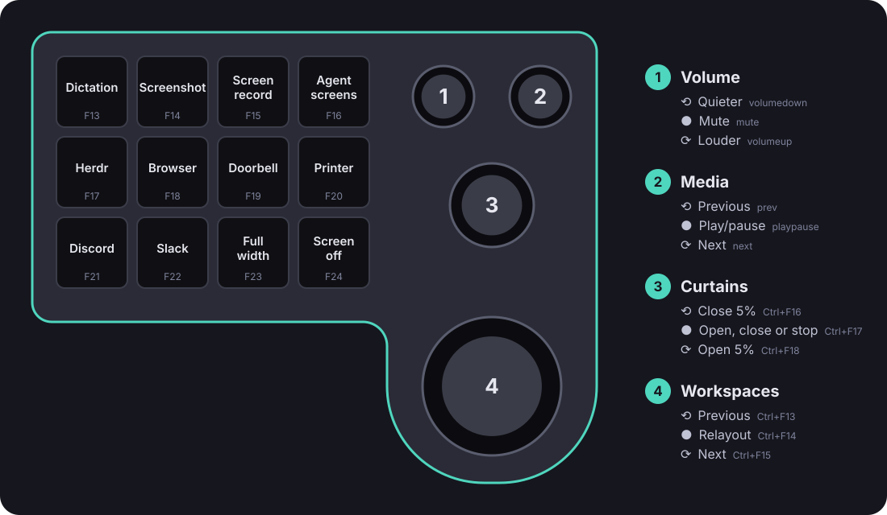

# Macro pad

Setup for a 12-key, 4-knob macro pad from AliExpress, sold as "Programming Custom Macro Keyboard Bluetooth Wired RGB 12 Keys 4 Knobs". It's a CH57x pad with USB ID `514c:8850`. The listing is gone, so nothing from the seller is needed.

The keys send F13 to F24, the middle knob Ctrl+F16 to Ctrl+F18 and the big knob Ctrl+F13 to Ctrl+F15. No other keyboard sends those, so they never clash with typing, and Hyprland gives each one its action in [`hypr/.config/hypr/bindings.lua`](../hypr/.config/hypr/bindings.lua). The middle knob moves the office curtains 5% a click through `ha-bridge cover increase-position` and `decrease-position`. The two small knobs send media keys, which work without any binds.

## Layout

[`layout.yaml`](layout.yaml) holds what every key and knob sends and what it does. Keys run in reading order from the top left, and knobs run small left, small right, medium, big. The picture above is drawn from it. Moving an action to another key only needs the label here and the bind in Hyprland; the pad keeps sending the same keys.

## WonKey

[`vendor/wonkey`](vendor/wonkey) is [wimpysworld/WonKey](https://github.com/wimpysworld/WonKey) at [`5c28bb6`](https://github.com/wimpysworld/WonKey/commit/5c28bb690e4cd0edb4df080cc5c6b20c207a2622) (0.2.5), cut down to its source and docs, with one patch: [`patches/0001-find-hid-devices-by-name.patch`](patches/0001-find-hid-devices-by-name.patch).

Upstream WonKey looks for the pad's HID device under its USB interface in sysfs and expects nothing else there but a few known entries. Newer kernels also add `physical_location` and `firmware_node`, so it gives up with "interface 0 requires exactly one HID device". The patch only counts entries named like an HID device (`0003:514C:8850.000D`).

[`udev-rules/60-ch57x-macropad.rules`](../udev-rules/60-ch57x-macropad.rules) lets you program the pad without root.

## Commands

| Command | What it does |
| --- | --- |
| `mise run macropad:build` | Builds the patched `wonkey` to `scripts/.local/bin`, which `dot stow` links |
| `mise run macropad:test` | Runs WonKey's tests for the pad's packages |
| `dot macropad read` | Shows what the pad holds now |
| `dot macropad apply` | Programs the pad from `layout.yaml`, on each of its `layers` |
| `dot macropad render` | Draws `layout.svg` and `layout.png` from `layout.yaml` |

Programming needs the USB cable, even on the wireless version, and the pad keeps its settings when unplugged.
